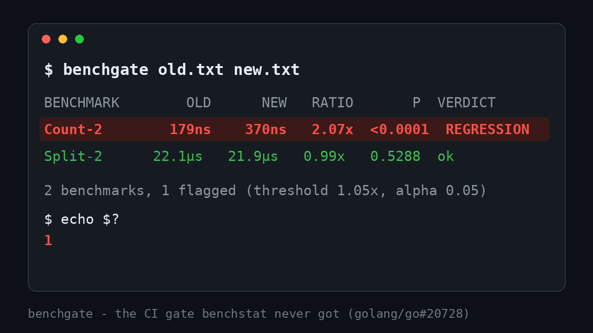

# benchgate



**benchstat shows you a benchmark regressed - and then exits 0.** There is no way to make it fail the build ([golang/go#20728](https://github.com/golang/go/issues/20728), open since 2017), so teams either skip performance gates or hand-roll awk scripts around benchstat output. benchgate is the missing gate: it compares two `go test -bench` result files with real statistics, and exits 1 when a benchmark got significantly slower.

```console
$ go test -bench=. -count=10 ./... > old.txt   # on main
$ go test -bench=. -count=10 ./... > new.txt   # on the PR
$ benchgate old.txt new.txt

BENCHMARK                                             OLD          NEW    RATIO        P  VERDICT
Count-2                                             179ns        370ns    2.07x  <0.0001  REGRESSION
Split-2                                        2.21e+04ns   2.19e+04ns    0.99x   0.5288  ok

2 benchmark(s), 1 flagged (threshold 1.05x, alpha 0.05)
$ echo $?
1
```

A regression only counts when **both** conditions hold: the median ratio crosses `--threshold` (default 1.05x) **and** the shift is statistically significant (`--alpha`, default 0.05, via a Mann-Whitney style test from `golang.org/x/perf/benchmath`). Requiring both magnitude and significance filters out most runner noise while still catching a real 30% slowdown.

Wire it into CI in three lines:

```yaml
- run: go test -bench=. -count=10 ./... > new.txt
- run: git checkout main -- . && go test -bench=. -count=10 ./... > old.txt && git checkout - -- .
- run: benchgate --annotate old.txt new.txt
```

`--annotate` emits GitHub Actions `::error` annotations, so the flagged benchmark shows up right on the PR diff.

## Why not...

- **benchstat** - by design it only reports; the maintainers have kept the "return exit code 1" feature request open since 2017. benchgate uses the same underlying statistics library (`x/perf/benchmath`) and adds the verdict.
- **A shell script around benchstat** - parsing aligned-column output is fragile, and "ratio > 1.2" alone fires on noisy runners. benchgate parses with `x/perf/benchfmt` (the format library) and gates on significance, not just magnitude.
- **A hosted perf dashboard** - great for trends over time, but it won't block the PR that introduces the regression. benchgate runs in the PR job itself, offline, in seconds.

## Install

```sh
go install github.com/ofershap/benchgate@latest
```

Or grab a binary from [Releases](https://github.com/ofershap/benchgate/releases).

### Install for agents

Tell your agent: "Install the Go CLI `github.com/ofershap/benchgate@latest`. Run the benchmarks on main and on my branch with `-count=10`, then run `benchgate old.txt new.txt` and fix anything it flags."

## Usage

```
benchgate [flags] OLD NEW

  OLD, NEW        `go test -bench=. -count=N` output files (- reads stdin)
  --threshold     fail when new/old median ratio reaches this (default 1.05)
  --alpha         p-value below which a shift counts as significant (default 0.05)
  --unit          measurement unit to compare: ns/op, B/op, allocs/op, ... (default ns/op)
  --annotate      print GitHub Actions ::error annotations for flagged benchmarks
  --no-fail       always exit 0, only report
```

Benchmarks that exist on only one side (added or removed) are listed but never flagged. Run with `--unit B/op` or `--unit allocs/op` to gate on allocations instead of time.

## How it decides

1. Parse both files with `golang.org/x/perf/benchfmt` - the same format library benchstat uses.
2. For each benchmark, summarize each side's median under no distributional assumption.
3. Compare the two samples with `x/perf/benchmath`'s distribution-free test to get a p-value.
4. Flag when ratio >= threshold AND p < alpha. Exit 1 if anything is flagged.

You want `-count=10` or more; with fewer samples the test has no power and benchgate will say so in the p column.

## Q&A

<details>
<summary><b>How do I fail CI when a Go benchmark regresses?</b></summary>
Run <code>go test -bench=. -count=10</code> on the base and the PR, save both outputs, then run <code>benchgate old.txt new.txt</code>. It exits 1 when a benchmark is slower by at least the threshold with statistical significance, so the job fails.
</details>

<details>
<summary><b>Does benchstat have an exit code for regressions?</b></summary>
No. golang/go#20728 asked for it in 2017 and it remains open. benchgate is the gate: same statistics, plus a verdict and an exit code.
</details>

<details>
<summary><b>How does benchgate avoid false positives on noisy CI runners?</b></summary>
It requires both a magnitude condition (median ratio >= threshold) and a significance condition (p < alpha from a distribution-free test over the repeated samples). A one-off slow sample moves neither enough to flag.
</details>

<details>
<summary><b>Can I gate on memory or allocations instead of time?</b></summary>
Yes: <code>--unit B/op</code> or <code>--unit allocs/op</code>. Run <code>go test -benchmem</code> so those columns exist.
</details>

<details>
<summary><b>Does it work with benchstat-style files or sub-benchmarks?</b></summary>
Yes. Input parsing is handled by x/perf/benchfmt, which understands the standard Go benchmark format including sub-benchmarks (Foo/bar-8) and full configuration lines.
</details>

## Contributing

Issues and PRs welcome - see [CONTRIBUTING.md](CONTRIBUTING.md). Please report security issues privately per [SECURITY.md](SECURITY.md).

---

## Author

[](https://gitshow.dev/ofershap)

[](https://linkedin.com/in/ofershap)
[](https://github.com/ofershap)
[](https://ofershap.github.io/)

---

<sub>README built with [README Builder](https://ofershap.github.io/readme-builder/)</sub>

## License

[MIT](LICENSE) &copy; [Ofer Shapira](https://github.com/ofershap)
